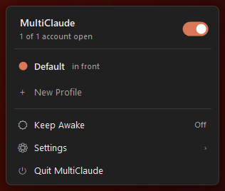

<div align="center">

# MultiClaude for Windows

**All your Claude accounts, open at once.** A small tray app for Windows 10 and 11.



</div>

The Claude desktop app signs in to one account at a time. If you have a personal plan and a work
seat, or one organization per client, switching means signing out, signing back in and losing
your place.

Claude accepts `--user-data-dir`: give each copy its own folder and each one keeps its own sign-in,
chats and settings. MultiClaude turns that into a tray icon: one click per account, live status,
and a separate taskbar button for each account.

This is an unofficial Windows port of [MultiClaude for macOS](https://github.com/QuentinCar0n/multiclaude)
by Soma Labs. It follows the same design, rewritten for Windows. See [Credits](#credits).

## Features

- **One profile per account.** Each profile is its own Claude data folder, so sign-ins and chats
  never mix.
- **Click to open, click again to bring forward.** No duplicate windows.
- **Live status.** A filled dot marks every account that's running; the header says how many are
  open and which one is in front.
- **Hover to quit** a single account. The header switch opens or quits all of them at once.
- **A color per account,** recolored from Claude's own logo on your PC (no Claude artwork ships
  with this app).
- **Its own taskbar button for each account**, named "Claude Work", "Claude Client" and so on,
  instead of every window stacking on one Claude button.
- **Start menu shortcut per account**, ready to pin to the taskbar or Start.
- **New Profile** in one line: type a name, press Enter, sign in to the new account in the window
  that opens.
- **Right-click a profile** to rename it, change its color, reorder it, open it when MultiClaude
  starts, show its data folder, duplicate it or take it off the list.
- **Claude Code per account.** Right-click → **Open Claude Code in Terminal** runs the CLI signed in
  as that account, with its own `CLAUDE_CONFIG_DIR`. **Copy Claude Code Command** gives you the
  PowerShell one-liner.
- **Copy MCP servers between accounts.** Set them up once, then right-click another profile →
  **Copy MCP Servers From**. Its config is backed up first.
- **Survives Claude updates.** When Claude updates itself it restarts on the default account only.
  MultiClaude notices the new version and reopens each profile on its own account.
- **Google and SSO sign-in that lands in the right window.** Each sign-in returns to the account
  that started it, with nothing to set up. See [Signing in](#signing-in-with-google-or-sso).
- **Keep Awake** for long Claude Code runs: 30 minutes to 8 hours, or until you turn it off,
  optionally keeping the display on too.
- **Shortcuts.** Ctrl+Alt+Shift+M opens the panel. Turn on account shortcuts and
  Ctrl+Alt+Shift+1 to 9 open each account.
- **Imports what you have.** Your default Claude account is always the first profile. Existing
  `Claude-*` profile folders, and any Claude already running with `--user-data-dir`, join the list
  on their own.
- **Launch at sign-in**, light and dark theme, no admin rights, no network access, no telemetry.

## Install

1. Install [Claude for Windows](https://claude.ai/download) if you haven't already.
2. Download `MultiClaude.exe` from the [latest release](https://github.com/tcollins590/multiclaude-windows/releases/latest).
   - `MultiClaude.exe` (small) needs the [.NET 8 Desktop Runtime](https://dotnet.microsoft.com/download/dotnet/8.0).
   - `MultiClaude-self-contained.exe` (larger) runs with nothing else installed.
3. Put it somewhere permanent, such as `%LOCALAPPDATA%\Programs\MultiClaude\`, and run it.

The executable isn't code-signed yet, so Windows SmartScreen may warn on first launch: choose
**More info → Run anyway**, or build it yourself (below).

Windows 11 hides new tray icons in the **^** overflow. Drag MultiClaude's icon onto the taskbar to
keep it in view, then turn on **Settings → Launch at Sign-In**.

## Use

1. Click the MultiClaude icon in the tray.
2. Click **New Profile**, type a name such as `Work`, press Enter.
3. A fresh Claude window opens. Sign in to your work account there.
4. From now on, click `Work` to open or bring it forward, and hover it to quit it.

Right-click the tray icon for a quick menu with every account, Settings and Keep Awake.

### Signing in with Google or SSO

Claude's Google and SSO sign-in comes back from the browser through a `claude://` link, and Windows
gives that link to your default Claude, not to the window that asked for it. With MultiClaude
running, the link goes to the Claude window you started the sign-in from instead: click
**Continue with Google** in the new profile's window, finish in the browser, and you land back in
that profile. Nothing to set up.

If a sign-in still lands in the wrong window, sign in with an **email code** in the profile's window,
or right-click the profile → **Open Alone to Sign In**, which closes your other accounts first so the
link can only land there. Each profile remembers its sign-in afterwards. **Settings → Send Sign-In
Links to the Right Account** turns the routing off.

## How it works

- **Opening** a profile runs Claude's own launcher with `--user-data-dir="<folder>"`: the Store
  build's `claude-desktop.exe` alias, or the older installer's `claude.exe`. The default profile
  runs it with no arguments. If that folder is already open, Claude's single-instance handling brings
  its window forward.
- **Profile data** lives in `%USERPROFILE%\.multiclaude\profiles\Claude-<Name>`, outside AppData on
  purpose: the Store build of Claude virtualizes writes under AppData into its package, where
  Explorer can't see them and Windows deletes them when the app is reset.
- **Status** comes from the running `claude.exe` processes: MultiClaude reads each one's
  `--user-data-dir` and matches it to a profile.
- **Taskbar buttons.** Every Claude window declares the same AppUserModelID, so all accounts would
  stack on one button. MultiClaude gives each profile's windows their own ID
  (`MultiClaude.Profile.<id>`), icon and relaunch command, then re-adds the button so the taskbar
  picks it up. The Start menu shortcut carries the same ID, so a pinned shortcut and the running
  window share one button.
- **Sign-in links.** Windows opens a `claude://` link by starting Claude with the link and no data
  folder; that process passes the link to the default account's window within a second or two and
  exits. While another account's window was the last Claude in front, MultiClaude checks for that
  short-lived process every 120 ms, stops it before it passes the link on, and starts Claude on the
  right account's folder with the link instead, which Claude hands to that account's open window.
  Nothing is registered or changed in Windows for this, and if MultiClaude ever misses one, the link
  goes to the default account as it would without MultiClaude. The log keeps only the link's path,
  never its sign-in code.
- **Updates.** When the installed Claude version changes, profiles that closed in the last ten
  minutes (and weren't quit from MultiClaude) are reopened.
- **Settings** are in `%APPDATA%\MultiClaude\config.json`. Icons and a small log are in
  `%LOCALAPPDATA%\MultiClaude`.

MultiClaude never modifies Claude. It doesn't patch, copy or re-sign the app, so Claude's updates
keep working.

## Known limitations

Some Claude features exist once per computer, so all profiles share them:

- **Quick Entry's global shortcut** belongs to whichever Claude opens first. In each profile's
  settings, turn it off or give it another key.
- **Open at login** in Claude's own settings: leave it alone in profiles. The Store build has one
  startup entry, so changing it in a profile changes it for your default Claude too. Use
  **Open When MultiClaude Starts** instead.
- **Claude in Chrome** pairs with one Claude at a time, usually the one that started last.
- **Cowork** runs one VM per Windows user, so it works in one profile at a time.
- **Tray icons.** Every Claude instance shows the same Claude tray icon. MultiClaude's panel and the
  taskbar buttons tell them apart.
- **Taskbar icon color.** The colored icon on a profile's taskbar button comes from its Start menu
  shortcut, which Windows picks up after it indexes the Start menu. Until then the button may show
  a plain icon (the separate button and its name work right away).
- **Claude Code inside the desktop app** (the Code tab) uses each profile's own account, but every
  profile shares `~/.claude`: Claude Code settings, skills, memory and transcripts. In a terminal,
  **Open Claude Code in Terminal** uses a separate `~/.claude-<name>` folder that signs in on its own.

## Build from source

Needs the [.NET 8 SDK](https://dotnet.microsoft.com/download/dotnet/8.0) or later.

```powershell
git clone https://github.com/tcollins590/multiclaude-windows.git
cd multiclaude-windows
./build.ps1          # writes dist\MultiClaude.exe and dist\self-contained\MultiClaude.exe
./build.ps1 -Run     # build and start it
```

Everything is in [`src/`](src): `TrayApp.cs` (the tray, menus and polling), `PanelForm.cs` (the
panel), `ClaudeApp.cs` (finding, opening and quitting Claude), `Native.cs` (Win32 and shell
interop), `LinkRouter.cs` (sign-in links), `Icons.cs` and `Config.cs`. No NuGet packages.

Pushing a `v*` tag builds both executables on GitHub Actions and publishes a release.

## Uninstall

1. Right-click the tray icon → **Settings** → turn off **Launch at Sign-In**, then **Quit MultiClaude**.
2. Delete `MultiClaude.exe`, `%APPDATA%\MultiClaude`, `%LOCALAPPDATA%\MultiClaude` and the
   `MultiClaude` folder in the Start menu (`%APPDATA%\Microsoft\Windows\Start Menu\Programs`).
3. Your profiles' sign-ins and chats stay in `%USERPROFILE%\.multiclaude\profiles` until you delete
   that folder too.

## Credits

- [MultiClaude for macOS](https://github.com/QuentinCar0n/multiclaude) by Quentin Caron /
  [Soma Labs](https://somalabs.me) (Apache 2.0): the idea, the design and the feature set this
  port follows. No code, text or artwork was copied; this app was written separately in C#.
- [multi-claude](https://github.com/thomasog/multi-claude) by Thomas O.G. (MIT): documented the
  Windows taskbar tagging and the AppData virtualization pitfall this app relies on.

## License

[Apache License 2.0](LICENSE). See [NOTICE](NOTICE).

Claude is a trademark of Anthropic, PBC. MultiClaude for Windows is not affiliated with or endorsed
by Anthropic.
